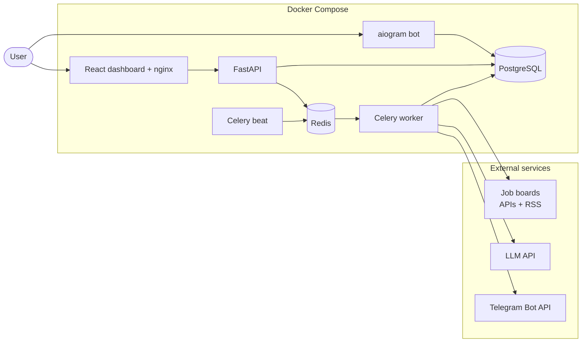

# AI Job Radar

> **Job aggregation → normalization → LLM matching → Telegram delivery.**
> A production-shaped service that watches public job boards, turns messy listings into a clean
> domain model, scores every vacancy against *your* profile with an LLM, and pushes only the relevant
> ones to Telegram. A React dashboard sits on top of the same API.

**Status:** ✅ complete — all stages delivered (architecture, foundation, collection, read API, AI
analysis, Celery automation, Telegram bot, React dashboard, hardening). See
[docs/ROADMAP.md](docs/ROADMAP.md) for the stage-by-stage history.


---

## Why this exists

A job seeker on the European/Russian remote market checks 5+ boards a day, reads the same
"Python Backend Developer" posting three times because it is syndicated, and still cannot answer the
only question that matters: **is this one worth my time?**

AI Job Radar answers that question automatically:

1. **Collect** — poll public APIs and RSS feeds on a schedule, idempotently, with retries and
   per-source rate limits.
2. **Normalize** — strip HTML, detect language / seniority / work format, parse salary into a
   comparable shape, extract technologies from a curated taxonomy.
3. **Deduplicate** — one canonical vacancy per real-world posting, no duplicate Telegram spam,
   even when the same job arrives from three sources.
4. **Analyze** — an LLM compares the vacancy with the user's profile and returns *structured* JSON:
   match score, strengths, gaps, red flags, and an `apply / consider / skip` recommendation.
5. **Deliver** — matched vacancies go to Telegram with inline actions (`Save`, `Applied`, `Skip`);
   every interaction feeds the user's history.
6. **Observe** — every collection run, LLM call, token cost and notification is recorded and
   exposed through a REST API and a dashboard.

## Core capabilities

| Area | What is implemented |
| --- | --- |
| Collection | Pluggable `VacancySource` adapters: hh.ru API, RemoteOK, Remotive, Arbeitnow, RSS (WeWorkRemotely). Shared HTTP client with timeouts, retries with jittered backoff, `429`/`Retry-After` handling, per-source rate limits. |
| Normalization | HTML → text, company canonicalization, salary parser (ranges, `k` notation, currencies, per hour/day/month/year), seniority & work-format detection, language detection, technology extraction with alias matching. |
| Deduplication | Source-level idempotency (`source_id + external_id`) **and** cross-source fingerprinting; provenance kept per source. |
| AI | `AIProvider` port with `OpenAIProvider` (structured outputs / JSON-schema) and a deterministic `MockAIProvider` so the whole stack runs without paid API keys. Versioned prompts, response validation, one repair retry, heuristic fallback. |
| Automation | Celery + Redis: beat schedule, per-source distributed locks, autoretry with exponential backoff, hard daily AI budget, `SKIP LOCKED` notification dispatch. |
| Bot | aiogram 3: `/start`, `/help`, `/profile`, `/jobs`, `/top`, `/stats`, `/settings`; FSM profile editor, inline vacancy actions, throttling and optional user allow-list. |
| API | FastAPI + Pydantic v2: pagination, filtering, sorting, validation, problem-style errors, OpenAPI docs with examples. |
| Dashboard | React 19 + TypeScript + Vite + Tailwind 4 + TanStack Query 5 + Recharts + React Router 7; overview KPIs, filterable jobs, AI verdict, profile editor, history. |
| Quality | 262 tests (pytest + Vitest), `ruff`, `mypy --strict`, ESLint, `tsc --noEmit`, Alembic migrations, GitHub Actions, Docker Compose one-command startup. |

## Architecture at a glance



Full component, sequence and layering diagrams: [docs/ARCHITECTURE.md](docs/ARCHITECTURE.md).
Database schema: [docs/DATABASE.md](docs/DATABASE.md).

## Tech stack

**Backend** — Python 3.12, FastAPI, SQLAlchemy 2.0 (async), Alembic, Pydantic v2, httpx,
Celery 5, Redis 7, PostgreSQL 16, pytest, structlog, ruff, mypy.

**Telegram** — aiogram 3.

**AI** — OpenAI-compatible API with JSON-schema structured outputs; deterministic mock provider for
offline runs and tests.

**Frontend** — React 19, TypeScript 5, Vite 6, Tailwind CSS 4, TanStack Query 5, Recharts 2,
React Router 7, Vitest + Testing Library.

**Infrastructure** — Docker, Docker Compose (7 services), nginx, GitHub Actions, Makefile.

## Repository layout

```
ai-job-radar/
├── backend/
│   ├── app/
│   │   ├── ai/             # provider port, OpenAI + mock, prompts
│   │   ├── api/            # FastAPI routers, schemas, mappers, deps
│   │   ├── bot/            # aiogram handlers, keyboards, notifier
│   │   ├── collectors/     # source adapters, HTTP client, rate limits
│   │   ├── normalization/  # text, salary, seniority, technologies, dedup
│   │   ├── repositories/   # SQLAlchemy queries
│   │   ├── services/       # use cases: collection, analysis, notifications
│   │   └── tasks/          # Celery app, runtime, locks, schedules
│   ├── alembic/            # migrations
│   └── tests/              # unit + integration + e2e
├── frontend/
│   ├── src/api/            # typed client and API types
│   ├── src/components/     # layout, UI primitives, job card
│   ├── src/pages/          # overview, jobs, detail, profile, history
│   └── src/lib/            # formatting helpers
├── docs/                   # architecture, database, roadmap, API, examples, ADRs
├── infra/                  # nginx and helper configs
├── docker-compose.yml
├── .env.example
└── Makefile
```

## Getting started

### Prerequisites

- Docker Desktop with the Linux engine (WSL 2 backend on Windows);
- 4 GB RAM free;
- optional: a Telegram bot token from [@BotFather](https://t.me/BotFather).

### 1. Start the stack

```bash
cp .env.example .env
# AI_PROVIDER=mock works without any paid key.
docker compose up -d --build
docker compose ps
```

Services:

| Service | URL / role |
| --- | --- |
| `api` | http://localhost:8000 — Swagger at `/docs`, OpenAPI at `/openapi.json` |
| `frontend` | http://localhost:3000 — dashboard |
| `postgres` | `localhost:5432`, database `radar` |
| `redis` | `localhost:6379` — broker, cache, locks |
| `worker` | Celery worker for `collect`, `analyze`, `notify`, `default` |
| `beat` | Celery beat schedule |
| `bot` | aiogram polling (starts only with `TELEGRAM_BOT_TOKEN`) |

The API container runs `alembic upgrade head` and `python -m app.cli seed` before uvicorn, so the
schema and reference data (5 sources, 93 technologies) exist on first boot.

### 2. Create a demo profile

The dashboard and the bot share one profile, identified by `X-Telegram-Id` / `DEMO_TELEGRAM_ID`.

```bash
docker compose exec api python -m app.cli demo
```

Or create it through the UI at http://localhost:3000/profile.

### 3. Collect and analyze

```bash
# one fast source
docker compose exec api python -m app.cli collect remoteok --max-pages 1

# enqueue analysis and delivery (the worker is already running)
docker compose exec worker celery -A app.tasks.celery_app:celery_app call \
  app.tasks.analysis.analyze_new_vacancies
docker compose exec worker celery -A app.tasks.celery_app:celery_app call \
  app.tasks.notifications.send_pending_notifications
```

Or simply wait: beat collects every 15 minutes, analyzes every 5 and dispatches every 2.

### 4. Connect Telegram (optional)

1. Create a bot with [@BotFather](https://t.me/BotFather) and copy the token.
2. Put it into `.env`:

   ```dotenv
   TELEGRAM_BOT_TOKEN=123456:ABC...
   TELEGRAM_ALLOWED_USER_IDS=[123456789]   # your numeric id, recommended
   ```

3. Restart the bot container:

   ```bash
   docker compose up -d bot
   ```

4. Open the bot, send `/start`, fill `/profile`, and wait for a match. Without a token the bot
   container exits cleanly and the rest of the stack keeps running.

### Local development (without Docker)

Backend:

```bash
cd backend
python -m venv .venv && . .venv/bin/activate     # Windows: .venv\Scripts\activate
pip install -e ".[dev]"
alembic upgrade head
python -m app.cli seed
uvicorn app.main:create_app --factory --reload --port 8000
```

Frontend (proxies `/api` to `localhost:8000`):

```bash
cd frontend
npm ci
npm run dev        # http://localhost:5173
```

## Testing and quality gates

```bash
cd backend
ruff check . && ruff format --check .
mypy app
pytest --cov=app --cov-report=term-missing --cov-fail-under=80

cd ../frontend
npm run lint
npm run build      # tsc --noEmit + vite build
npm test -- --run
```

Current baseline: **251 backend tests + 11 frontend tests**, backend coverage **82%**,
`mypy --strict` clean, ruff/ESLint clean, production Vite build split into vendor chunks.

Integration tests need PostgreSQL and Redis; the CI workflow provides both as services. Locally,
`TEST_DATABASE_URL` and `TEST_REDIS_URL` select dedicated instances.

## API

Base path: `/api/v1`. Interactive docs: `/docs`. Full reference with curl examples:
[docs/API.md](docs/API.md).

| Method | Path | Purpose |
| --- | --- | --- |
| `GET` | `/jobs` | Filterable, paginated vacancy feed |
| `GET` | `/jobs/{id}` | Vacancy detail |
| `POST` | `/jobs/{id}/analyze` | Run/reuse AI analysis (API key) |
| `GET` | `/jobs/{id}/analysis` | Latest cached analysis |
| `GET` | `/companies`, `/technologies` | Catalogs |
| `GET` | `/stats` | Dashboard aggregates (Redis-cached) |
| `GET`/`PUT` | `/profile` | Matching profile (PUT requires API key) |
| `GET` | `/history` | User statuses and counts |
| `GET` | `/health/live`, `/health/ready` | Probes |

Authentication: write endpoints require `X-API-Key`; user-scoped reads use `X-Telegram-Id`. This is a
portfolio-scale trust model — a real multi-user deployment should put per-user sessions in front.

## Documentation

| Document | Contents |
| --- | --- |
| [docs/ARCHITECTURE.md](docs/ARCHITECTURE.md) | Context/container diagrams, layering rules, ports & adapters, pipelines, scheduling, failure handling |
| [docs/DATABASE.md](docs/DATABASE.md) | ER diagram, every table and index, dedup keys, retention, migration policy |
| [docs/API.md](docs/API.md) | Endpoint reference, filters, errors, curl examples |
| [docs/EXAMPLES.md](docs/EXAMPLES.md) | Real AI verdict, Telegram message and bot flow |
| [docs/ROADMAP.md](docs/ROADMAP.md) | Delivery stages and definition of done |
| [docs/adr/](docs/adr/) | Architecture Decision Records |

## Future improvements

- Real per-user authentication (OIDC/session cookies) instead of the demo header model.
- Telegram webhook mode for lower latency and horizontal scaling.
- Prometheus metrics and OpenTelemetry traces around collectors, LLM calls and dispatcher.
- Embedding-based dedup for near-duplicate descriptions.
- Active learning from `Applied`/`Skip` feedback to tune prefilters and prompts.
- More sources (LinkedIn is intentionally excluded — no public API), per-source circuit breakers.
- Redis-backed bot throttling and i18n for the bot and dashboard.
- MSW-based component tests and Lighthouse budget in CI.

## License

MIT
