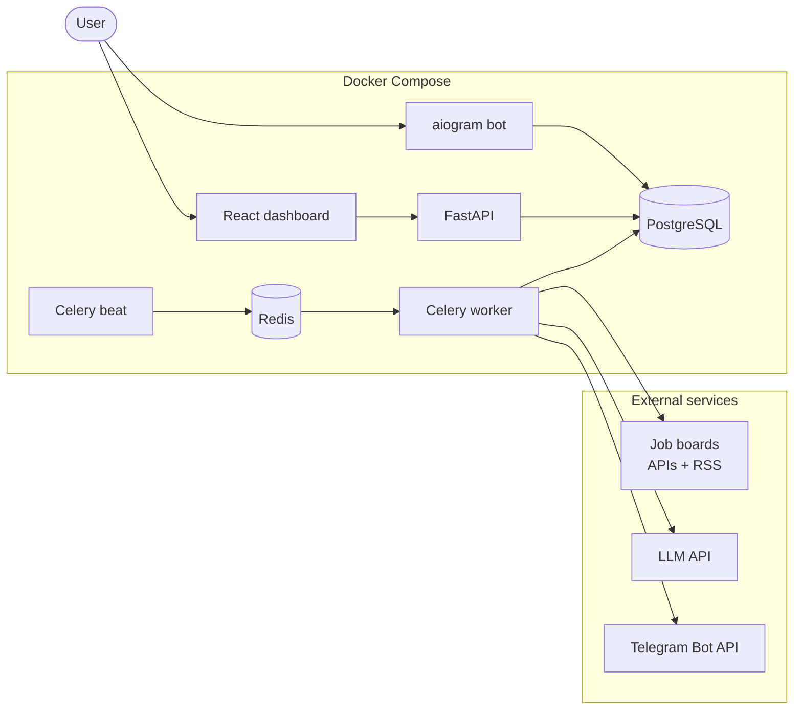

# AI Job Radar

> **Job aggregation → normalization → LLM matching → Telegram delivery.**
> A production-shaped service that watches several public job boards, turns messy listings into a
> clean domain model, scores every vacancy against *your* profile with an LLM, and pushes only the
> relevant ones to Telegram. A web dashboard sits on top of the same API.

**Status:** 🚧 under active development — Stages 0–3 complete (architecture, foundation, collection
and normalization, read API). See [docs/ROADMAP.md](docs/ROADMAP.md) for stage-by-stage progress.

---

## Why this exists

A job seeker on the European/Russian remote market checks 5+ boards a day, reads the same
"Python Backend Developer" posting three times because it is syndicated, and still cannot answer the
only question that matters: **is this one worth my time?**

AI Job Radar answers that question automatically:

1. **Collect** — poll public APIs and RSS feeds on a schedule, idempotently, with retries and
   per-source rate limits.
2. **Normalize** — strip HTML, detect language / seniority / work format, parse salary into a
   comparable shape, extract technologies from a curated taxonomy.
3. **Deduplicate** — one canonical vacancy per real-world posting, no duplicate Telegram spam,
   even when the same job arrives from three sources.
4. **Analyze** — an LLM compares the vacancy with the user's profile and returns *structured* JSON:
   match score, strengths, gaps, red flags, and an `apply / consider / skip` recommendation.
5. **Deliver** — matched vacancies go to Telegram with inline actions (`Save`, `Applied`, `Skip`);
   every interaction feeds the user's history.
6. **Observe** — every collection run, LLM call, token cost and notification is recorded and
   exposed through a REST API and a dashboard.

## Core capabilities

| Area | What is implemented |
| --- | --- |
| Collection | Pluggable `VacancySource` adapters: hh.ru API, RemoteOK, Remotive, Arbeitnow, RSS (WeWorkRemotely). Shared HTTP client with timeouts, retries with jittered backoff, `429`/`Retry-After` handling, token-bucket rate limits. |
| Normalization | HTML → text, company name canonicalization, salary parser (ranges, `k` notation, currencies, per hour/day/month/year), seniority & work-format detection, language detection, technology extraction with alias matching. |
| Deduplication | Source-level idempotency (`source_id + external_id`) **and** cross-source fingerprinting; provenance kept per source. |
| AI | `AIProvider` port with `OpenAIProvider` (structured outputs / JSON-schema) and a deterministic `MockAIProvider` so the whole stack runs with zero paid API keys. Versioned prompts, response validation, one repair retry, heuristic fallback. |
| Automation | Celery + Redis: beat schedule, per-source distributed locks, autoretry with exponential backoff, hard daily AI budget. |
| Bot | aiogram 3: `/start`, `/profile`, `/jobs`, `/top`, `/settings`, `/stats`, `/help`; FSM-based profile editing, inline vacancy actions, throttling middleware. |
| API | FastAPI + Pydantic v2: pagination, filtering, sorting, validation, problem-style errors, OpenAPI docs with examples. |
| Dashboard | React + TypeScript + Vite + Tailwind + shadcn/ui + TanStack Query + Recharts. |
| Quality | pytest (unit / integration / e2e), `ruff`, `mypy`, Alembic migrations, GitHub Actions, Docker Compose one-command startup. |

## Architecture at a glance



Full component, sequence and layering diagrams: [docs/ARCHITECTURE.md](docs/ARCHITECTURE.md).
Database schema: [docs/DATABASE.md](docs/DATABASE.md).

## Tech stack

**Backend** — Python 3.12+, FastAPI, SQLAlchemy 2.0 (async), Alembic, Pydantic v2, httpx,
Celery 5, Redis 7, PostgreSQL 16, pytest, structlog, ruff, mypy.

**Telegram** — aiogram 3.

**AI** — OpenAI-compatible API with JSON-schema structured outputs; deterministic mock provider for
offline runs and tests.

**Frontend** — React 18, TypeScript 5, Vite, Tailwind CSS, shadcn/ui, TanStack Query, Recharts.

**Infrastructure** — Docker, Docker Compose (7 services), GitHub Actions, Makefile.

## Repository layout

```
ai-job-radar/
├── backend/            # FastAPI app, Celery workers, bot, collectors, AI layer
├── frontend/           # React + TypeScript dashboard
├── docs/               # architecture, database, roadmap, ADRs, API reference
├── infra/              # nginx and docker helper configs
├── docker-compose.yml
├── .env.example
└── Makefile
```

## Documentation

| Document | Contents |
| --- | --- |
| [docs/ARCHITECTURE.md](docs/ARCHITECTURE.md) | Context/container diagrams, layering rules, ports & adapters, pipelines, scheduling, failure handling |
| [docs/DATABASE.md](docs/DATABASE.md) | ER diagram, every table and index, dedup keys, retention, migration policy |
| [docs/ROADMAP.md](docs/ROADMAP.md) | Delivery stages, definition of done for each stage |
| [docs/adr/](docs/adr/) | Architecture Decision Records |

## Getting started

> Filled in at **Stage 8**. Planned developer flow:

```bash
cp .env.example .env          # choose AI_PROVIDER=mock to run without an API key
docker compose up --build      # api, worker, beat, bot, postgres, redis, frontend
# API docs:  http://localhost:8000/docs
# Dashboard: http://localhost:3000
```

## License

MIT
