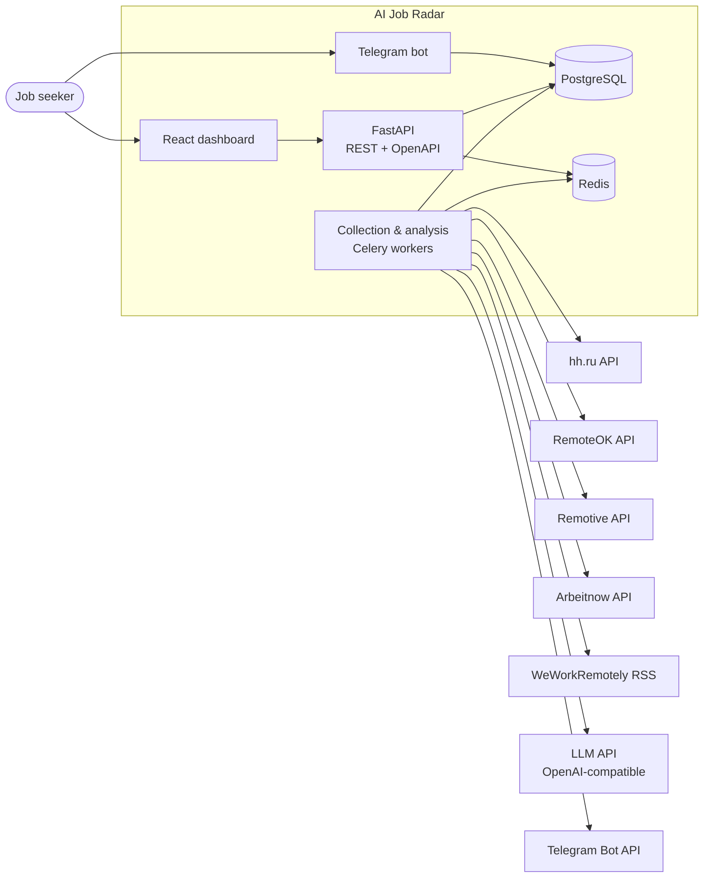
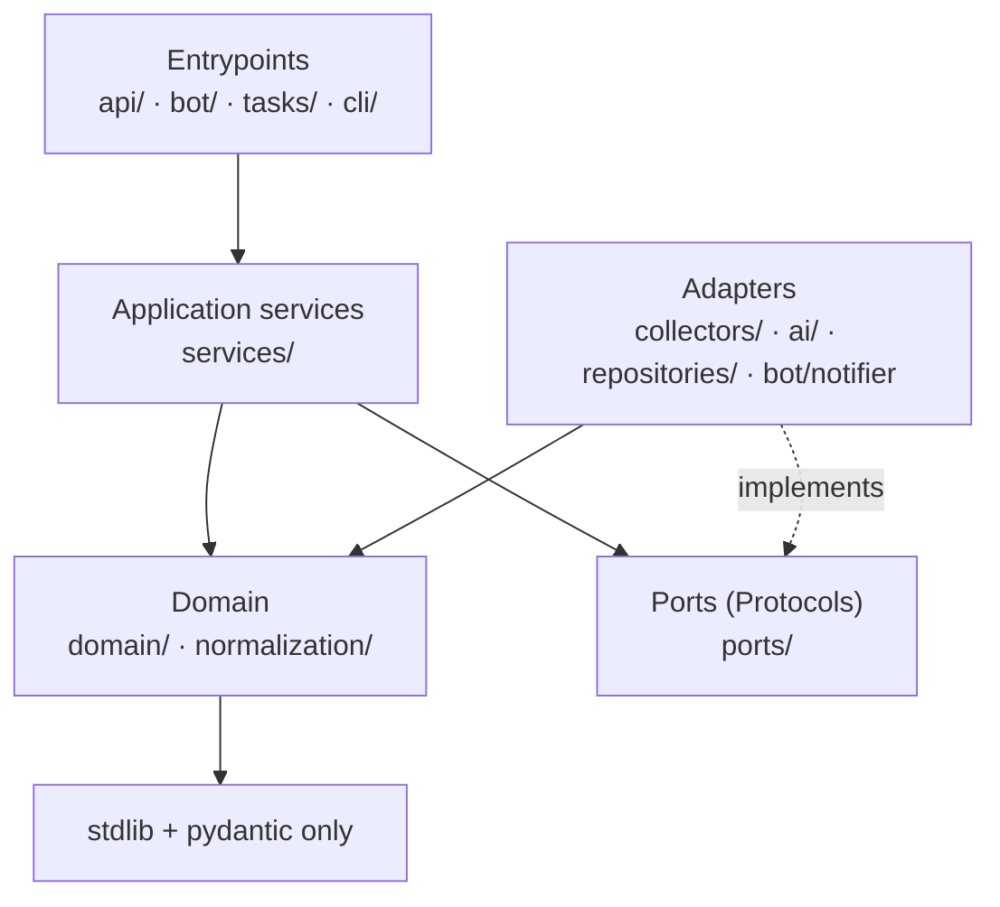
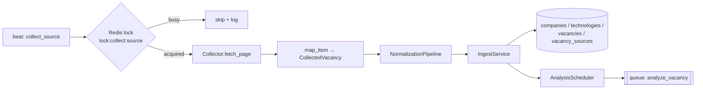
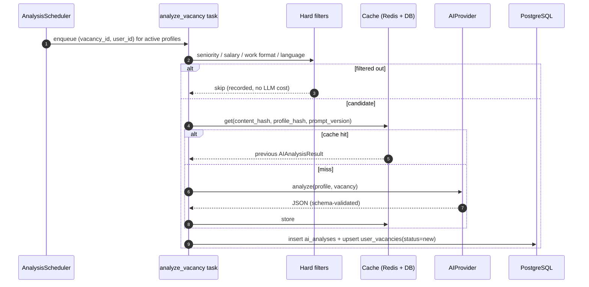
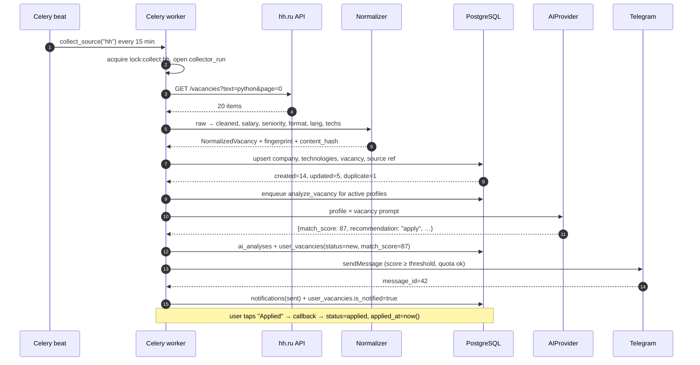

# Architecture

This document describes *how* AI Job Radar is built and *why*. It is the reference for every
implementation stage; if code and document disagree, one of them is a bug.

---

## 1. Goals and constraints

**Goals**

- Collect vacancies from several heterogeneous public sources without writing per-source business
  logic in the service layer.
- Normalize dirty, multilingual, marketing-heavy text into a queryable model.
- Never notify the same vacancy twice, never store the same vacancy twice.
- Produce a *useful* LLM judgement (not a summary) cheaply: hard filters before the model, caching
  after it, budget caps around it.
- Run end-to-end with `docker compose up` and **without any paid API key** (`AI_PROVIDER=mock`).
- Be pleasant to test: pure normalization functions, faked ports, fixtures instead of live HTTP.

**Constraints**

- Public sources only. No authentication bypass, no robots.txt violations, no aggressive scraping.
- Single-tenant demo scope: one Postgres, one Redis, one worker pool. Scaling notes in §12.
- Telegram is the delivery channel; the web UI is read-mostly.

**Non-goals (v1)**

- Automatic job application, resume generation, recruiter CRM.
- Multi-region active-active deployment.
- Per-user isolation hardening beyond API-key/dev-user model (documented in §11).

---

## 2. System context



Redis carries three unrelated workloads — keep that in mind when sizing it: Celery broker/result
backend, distributed locks (`lock:collect:*`), and short-lived caches (stats, rate-limit buckets).

---

## 3. Containers

| Container | Image / build | Responsibility | Scales with |
| --- | --- | --- | --- |
| `api` | `backend/Dockerfile` (uvicorn) | Read API, profile CRUD, manual analysis trigger, OpenAPI | request rate |
| `worker` | same image, `celery -A app.tasks.celery_app worker` | Collection, normalization, AI calls, notifications | queue depth |
| `beat` | same image, `celery ... beat` | Schedule only (must be exactly one replica) | — |
| `bot` | same image, `python -m app.bot` | aiogram polling/webhook, profile FSM, inline actions | user count |
| `frontend` | `frontend/Dockerfile` (nginx) | Static SPA + reverse proxy to `api` | — |
| `postgres` | `postgres:16-alpine` | System of record | data size |
| `redis` | `redis:7-alpine` | Broker, locks, cache | task rate |

Only `api` and `frontend` are exposed publicly; `postgres`, `redis` and `worker` stay on the
internal network.

---

## 4. Layering and the dependency rule

Dependencies point **inward**. A module may only import from the layers below it:



| Package | Responsibility | Allowed imports |
| --- | --- | --- |
| `app/domain` | Enums, DTOs, matching policy (pure functions) | stdlib, pydantic |
| `app/normalization` | HTML cleaning, salary/seniority/format/language parsing, tech extraction | `domain`, stdlib, `selectolax`/`regex` |
| `app/ports` | `VacancySource`, `AIProvider`, `Notifier`, `Cache`, `Clock` protocols | `domain`, stdlib |
| `app/services` | Use cases and transaction boundaries | `domain`, `ports`, `repositories`, `schemas` |
| `app/repositories` | SQLAlchemy 2.0 queries, no business rules | `models`, `schemas` |
| `app/collectors` | Implementations of `VacancySource` | `ports`, `domain`, shared HTTP client |
| `app/ai` | Implementations of `AIProvider` | `ports`, `domain`, `prompts` |
| `app/models` | ORM mapping only (no queries, no logic) | `domain` enums, `db` |
| `app/api`, `app/bot`, `app/tasks` | Transport/wiring: parse input, call a service, format output | everything below |
| `app/core` | Settings, logging, redis client, exceptions | stdlib, libs |

Practical rule: **services never import `httpx`, `aiogram` or `openai`**. Those live behind ports.
That is what makes the collector and AI layers swappable and testable with fakes.

---

## 5. Ports and adapters

### 5.1 `VacancySource`

```python
# app/ports/vacancy_source.py
class VacancySource(Protocol):
    code: str

    async def collect(self, ctx: CollectorContext) -> AsyncIterator[CollectedVacancy]:
        """Yield source-agnostic DTOs. Must be idempotent and safe to retry."""
```

`BaseCollector` implements `collect()` once — pagination, retries, rate limiting, logging, metrics —
and requires subclasses to implement only:

```python
async def fetch_page(self, page: int, ctx: CollectorContext) -> Page: ...
def map_item(self, item: Mapping[str, Any]) -> CollectedVacancy: ...
```

So a new source is ~80 lines of mapping code. `map_item` must not raise on missing optional fields;
it returns `None` for items that are unusable, and the base class counts them as `skipped`.

### 5.2 `AIProvider`

```python
# app/ports/ai_provider.py
class AIProvider(Protocol):
    name: str

    async def analyze(self, profile: ProfileSnapshot, vacancy: VacancySnapshot) -> AIAnalysisResult: ...
```

`AIAnalysisResult` is a Pydantic model that *is* the contract from the brief: `match_score`,
`experience_match`, `skills_match`, `missing_skills`, `strong_matches`, `red_flags`,
`recommendation`, `reason`. Any provider — OpenAI, local model, mock — must return it.

### 5.3 `Notifier`

```python
class Notifier(Protocol):
    async def send_vacancy_match(self, chat_id: int, payload: NotificationPayload) -> SentMessage: ...
```

Implemented by `app/bot/notifier.py` (`TelegramNotifier`); writes `notifications` rows itself so a
failed send is visible even if the caller crashes.

---

## 6. Collection pipeline



### 6.1 Normalization pipeline

Ordered, pure, and individually unit-tested. Every stage is total: it degrades instead of raising.

| # | Stage | Input → output | Failure mode |
| --- | --- | --- | --- |
| 1 | `clean_html` | raw HTML → plain text, entities decoded, whitespace collapsed, `li` → `•` | empty text |
| 2 | `normalize_company` | `"Acme, Inc."` / `"ACME LLC"` → canonical display + comparison key | fall back to raw name |
| 3 | `parse_salary` | `"€1.2k–1.8k / month"` → `Salary(min, max, currency, period, is_estimated)` | `None` fields, `is_estimated=true` when inferred |
| 4 | `detect_seniority` | title + first 1 500 chars → `intern…lead` | `unknown` |
| 5 | `detect_work_format` | location + text markers → `remote/hybrid/office` | `unknown` |
| 6 | `detect_language` | description → `en/ru/uk/de/pl/other` | `unknown` |
| 7 | `extract_technologies` | text → `[(Technology, is_required, mentions)]` | `[]` |
| 8 | `fingerprint` | company + title + location key → `sha256` | always succeeds |

Technology extraction uses a curated YAML taxonomy (`app/normalization/data/technologies.yml`)
compiled into one case-insensitive regex with word boundaries, longest aliases first
(`postgresql` before `postgres`, `c#` before `c`), so `"C++"` never matches `"C"`.

### 6.2 Deduplication

Two independent keys:

1. **Idempotency per source** — `vacancy_sources (source_id, external_id)` is unique, so re-running a
   collector updates `last_seen_at` instead of inserting.
2. **Cross-source identity** — `vacancies.fingerprint` is unique, computed from
   `normalize(company) | normalize(title) | location_key`. If a second source delivers the same
   posting, it attaches a new `vacancy_sources` row to the existing vacancy (richer description wins)
   and no second notification is ever generated.

`content_hash` (SHA-256 of the cleaned description) tells us whether a re-seen vacancy actually
changed. Analysis is only re-run when `content_hash` or the user's `profile_hash` changes.

Why not hash the URL: the same posting is syndicated under different URLs, and
`utm_source`/tracking parameters would defeat it. Why not hash the whole description: every board
rewrites whitespace and boilerplate, which would defeat that too. Decision record:
[ADR-0003](adr/0003-canonical-vacancy-with-source-provenance.md).

### 6.3 Source adapters

| Source | Protocol | Notes |
| --- | --- | --- |
| hh.ru | JSON API | requires descriptive `User-Agent`; paginated, 20/page |
| RemoteOK | JSON API | asks for attribution + link back; single large payload |
| Remotive | JSON API | polite polling, no auth |
| Arbeitnow | JSON API | paginated |
| WeWorkRemotely | RSS | `feedparser`, HTML inside `description` |

Each adapter lives in its own module, declares `code`, `rate_limit_per_min` and a default config
block, and is registered in `app/collectors/registry.py`. Disabling a source is a DB flag
(`sources.is_enabled`), not a code change.

---

## 7. Analysis pipeline



**Hard filters first** — the LLM is the most expensive component, so obviously irrelevant vacancies
never reach it: target seniority mismatch, salary below the profile floor (only when a salary is
known), work format not accepted, language not understood.

**Structured output** — the provider is asked for JSON matching `AIAnalysisResult`. The response is
validated by Pydantic; on validation failure the service performs exactly one repair attempt with
the validation error appended to the prompt. A second failure falls back to the deterministic
heuristic scorer and marks the row `is_degraded=true`. The pipeline never crashes because a model
returned prose.

**Cost control** — `AI_MIN_MATCH_SCORE` prefilter, `AI_MAX_ANALYSES_PER_RUN`, `AI_DAILY_BUDGET_USD`
(checked against `SUM(cost_usd)` for the current UTC day), cache by
`(content_hash, profile_hash, prompt_version)`, and a hard cap on prompt size (description truncated
to 6 000 chars, tail dropped first).

**Prompt versioning** — prompts live in `app/ai/prompts/` as versioned templates (`v1.py`), and the
version string is stored on every analysis row, so old and new scores are never mixed silently.

---

## 8. Notification pipeline

1. `send_pending_notifications` selects `user_vacancies` where `status='new'`, `is_notified=false`,
   `match_score >= profile.min_match_score`, user is active, notifications enabled, daily quota not
   exhausted.
2. Rows are claimed with `SELECT … FOR UPDATE SKIP LOCKED` (batch of 20) to stay safe with several
   workers.
3. `TelegramNotifier` renders the message (HTML-escaped, truncated), sends it, persists
   `notifications(status, telegram_message_id)`.
4. On `TelegramForbiddenError` the user is deactivated; on `RetryAfter` the task retries after the
   given delay; on other errors the notification is marked `failed` with the error text.

Quiet hours and digests are deliberately deferred (see *Future Improvements* in the final README).

---

## 9. Scheduling, concurrency, failure handling

| Task | Schedule | Retry policy | Lock |
| --- | --- | --- | --- |
| `collect_source(code)` | every 15 min per enabled source | 3× exponential (30 s → 8 min), not on 4xx | `lock:collect:{code}` (10 min TTL) |
| `analyze_new_vacancies` | every 5 min | 3× | `lock:analyze` |
| `send_pending_notifications` | every 2 min | 2× | `SKIP LOCKED` only |
| `refresh_stats_cache` | every 5 min | 1× | — |
| `deactivate_stale_vacancies` | daily 03:00 | 1× | — |

Celery settings that matter: `task_acks_late=True`, `worker_prefetch_multiplier=1`,
`task_reject_on_worker_lost=True`, `broker_transport_options.visibility_timeout=3600`,
`worker_max_tasks_per_child=200` (guards against leaks in parser libs), UTC everywhere.

Failure taxonomy:

| Failure | Behaviour |
| --- | --- |
| Source 5xx / timeout | retry with jitter; after exhaustion `collector_runs.status='failed'`, other sources unaffected |
| Source 429 | honour `Retry-After`, back off, do not retry immediately |
| Source schema drift | item skipped + warning with source code and payload hash; run status `partial` |
| Normalizer bug | per-stage degradation; vacancy still stored with `unknown` fields |
| LLM invalid JSON | one repair attempt → heuristic fallback (`is_degraded`) |
| LLM outage / budget exhausted | analysis postponed, vacancies stay in queue; nothing lost |
| Telegram blocked by user | user deactivated, notification marked `failed` |

---

## 10. Cross-cutting concerns

**Configuration** — `pydantic-settings`, one `Settings` object, `.env` for local and compose,
secrets never logged (`SecretStr`). Fail-fast validation at import time.

**Logging** — `structlog` JSON in containers, pretty console locally. A `request_id`/`task_id`
contextvar is bound in middleware and Celery signals, so a single vacancy's journey is greppable:
`collect → normalize → ingest → analyze → notify`.

**Observability** — `collector_runs` is the operational ledger (fetched/created/updated/skipped,
duration, error). `ai_analyses` stores latency, tokens and cost. `/health/live` and `/health/ready`
for orchestration; optional Prometheus metrics behind a flag.

**Caching** — Redis: `stats:*` (60 s TTL), technology list (5 min), analysis lookups (keyed by hashes,
24 h). The DB remains the source of truth; every cache is optional for correctness.

**Security** — API key for write endpoints (`X-API-Key`), dev-mode fallback user for local demo,
Telegram ID allow-list optional, per-user throttling middleware in the bot, HTML escaping of every
user-controlled string rendered into Telegram messages, no raw SQL string interpolation.

---

## 11. Source compliance

- Only public, documented endpoints; RSS where offered.
- Descriptive `User-Agent` with a contact address (`AI-Job-Radar/1.0 (+https://github.com/…)`).
- Per-source `rate_limit_per_min` token bucket; default 30 req/min, hh.ru 10 req/min.
- Response caching inside a run; `If-Modified-Since` where the source supports it.
- Attribution: each notification links to the original posting; RemoteOK additionally gets a
  source credit.
- A source can be disabled in DB or by removing its registration — no code changes elsewhere.

---

## 12. Scaling path

| Bottleneck | First step | Next step |
| --- | --- | --- |
| Collection volume | more workers, `-Q collect` queue | per-source queues + prefetch tuning |
| API reads | indexes + Redis stat cache | read replica, `pg_stat_statements` review |
| AI cost | cache + prefilters (done) | batch scoring, cheaper model for triage |
| Vacancy table growth | partial indexes on `is_active` | monthly partitions by `published_at` |
| Duplicate notifications | unique constraint (done) | per-user digest windows |

---

## 13. End-to-end data flow


