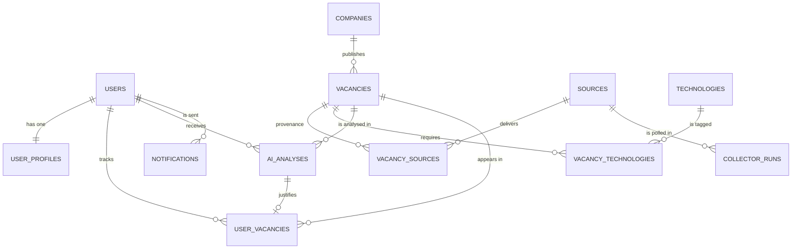
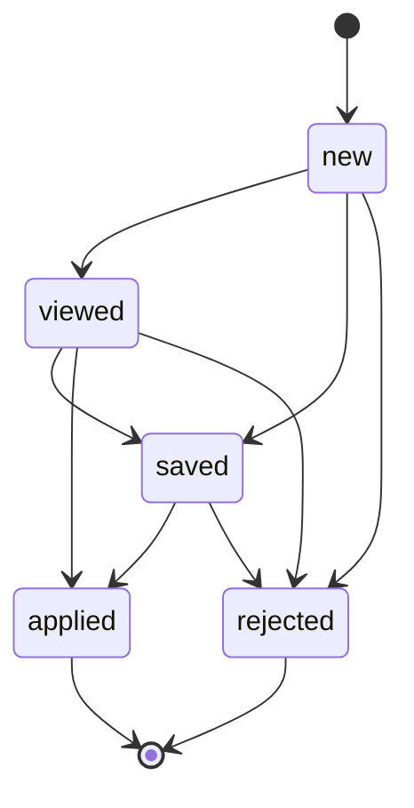

# Database design

PostgreSQL 16, SQLAlchemy 2.0 (async, `asyncpg`), Alembic migrations.

---

## 1. Conventions

| Concern | Decision |
| --- | --- |
| Primary keys | `uuid` (`gen_random_uuid()`), generated in DB |
| Time | `timestamptz`, always UTC; `created_at`/`updated_at` on mutable tables |
| Naming | `snake_case`, plural tables, explicit constraint names via metadata naming convention (`ix_`, `uq_`, `fk_`, `ck_`) so Alembic autogenerate is deterministic |
| Enums | native PostgreSQL types, values are lowercase strings, `unknown` member instead of `NULL` |
| Arrays | `text[]` for small, unordered, profile-owned lists; join tables for anything queried statistically |
| Money | integer minor-unit-free amounts + ISO-4217 `char(3)`; a normalized `salary_monthly_eur numeric(12,2)` for cross-currency filters |
| Soft delete | only `vacancies.is_active` (staleness); users are deactivated, never hard-deleted |
| Multi-tenancy | none — one deployment serves one user set; `user_id` scoping on read endpoints |

---

## 2. Entity-relationship diagram

`vacancies` is the canonical posting. `vacancy_sources` is the provenance ledger: one row per
(source, external id) that delivered this posting, so the same job collected from hh.ru and RemoteOK
is **one** vacancy with **two** source references.

---

## 3. Enumerated types

| Type | Values |
| --- | --- |
| `work_format` | `remote`, `hybrid`, `office`, `unknown` |
| `seniority_level` | `intern`, `junior`, `middle`, `senior`, `lead`, `unknown` |
| `salary_period` | `hour`, `day`, `month`, `year`, `unknown` |
| `vacancy_language` | `en`, `ru`, `uk`, `de`, `pl`, `es`, `other`, `unknown` |
| `english_level` | `a1`, `a2`, `b1`, `b2`, `c1`, `c2`, `native`, `unknown` |
| `technology_category` | `language`, `framework`, `database`, `devops`, `cloud`, `frontend`, `mobile`, `testing`, `messaging`, `other` |
| `source_kind` | `json_api`, `rss`, `html` |
| `collector_run_status` | `running`, `success`, `partial`, `failed` |
| `recommendation` | `apply`, `consider`, `skip` |
| `user_vacancy_status` | `new`, `viewed`, `saved`, `applied`, `rejected` |
| `notification_channel` | `telegram` |
| `notification_status` | `pending`, `sent`, `failed`, `skipped` |

---

## 4. Tables

### 4.1 `users`

| Column | Type | Constraints | Notes |
| --- | --- | --- | --- |
| `id` | uuid | PK, default `gen_random_uuid()` | |
| `telegram_id` | bigint | not null, unique | primary identity for the bot |
| `username` | varchar(64) | null | without `@`, may change |
| `first_name` | varchar(128) | null | |
| `timezone` | varchar(64) | not null, default `UTC` | IANA name, used for quotas/quiet hours later |
| `is_active` | boolean | not null, default `true` | set false on `TelegramForbiddenError` |
| `last_seen_at` | timestamptz | null | updated by bot middleware |
| `created_at`, `updated_at` | timestamptz | not null, default `now()` | |

### 4.2 `user_profiles`

| Column | Type | Constraints | Notes |
| --- | --- | --- | --- |
| `id` | uuid | PK | |
| `user_id` | uuid | not null, unique, FK → `users` ON DELETE CASCADE | 1:1 |
| `headline` | varchar(160) | null | free-form summary shown in the bot |
| `desired_positions` | text[] | not null, default `{}` | e.g. `{Python Backend Developer}` |
| `target_seniority` | seniority_level[] | not null, default `{}` | empty = any |
| `skills` | text[] | not null, default `{}` | canonical technology names |
| `preferred_stack` | text[] | not null, default `{}` | weighted positively by the prompt |
| `excluded_stack` | text[] | not null, default `{}` | hard negative signal |
| `english_level` | english_level | not null, default `unknown` | |
| `min_salary_amount` | integer | null, check ≥ 0 | in `salary_currency` |
| `salary_currency` | char(3) | not null, default `EUR` | |
| `preferred_locations` | text[] | not null, default `{}` | country codes / city names |
| `work_formats` | work_format[] | not null, default `{}` | empty = any |
| `min_match_score` | smallint | not null, default 70, check 0–100 | notification threshold |
| `notifications_enabled` | boolean | not null, default `true` | |
| `max_notifications_per_day` | smallint | not null, default 10 | fairness valve |
| `profile_hash` | char(64) | not null | SHA-256 of the fields above; AI cache key |
| `created_at`, `updated_at` | timestamptz | not null, default `now()` | |

Arrays are deliberate: profile attributes are read as a whole, never aggregated in SQL, and keeping
them in one row makes the hash cheap to compute. The trade-off is documented in
[ADR-0004](adr/0004-profile-attributes-as-arrays.md) — if profile analytics become a feature,
`skills` moves to `user_skills(user_id, technology_id, level)`.

### 4.3 `sources`

| Column | Type | Constraints | Notes |
| --- | --- | --- | --- |
| `id` | uuid | PK | |
| `code` | varchar(32) | not null, unique | `hh`, `remoteok`, `remotive`, `arbeitnow`, `weworkremotely` |
| `name` | varchar(128) | not null | human label for the dashboard |
| `kind` | source_kind | not null | |
| `base_url` | text | null | |
| `is_enabled` | boolean | not null, default `true` | kill switch without redeploy |
| `rate_limit_per_min` | smallint | not null, default 30 | consumed by the token bucket |
| `config` | jsonb | not null, default `{}` | source-specific knobs (query, tags, page cap) |
| `last_success_at` | timestamptz | null | freshness indicator in `/stats` |
| `created_at`, `updated_at` | timestamptz | not null, default `now()` | |

### 4.4 `companies`

| Column | Type | Constraints | Notes |
| --- | --- | --- | --- |
| `id` | uuid | PK | |
| `name` | varchar(255) | not null | display form, e.g. `Acme` |
| `normalized_name` | varchar(255) | not null, unique | comparison key: lowercase, legal suffixes and punctuation stripped |
| `website` | text | null | |
| `logo_url` | text | null | |
| `created_at`, `updated_at` | timestamptz | not null, default `now()` | |

`normalized_name` is the deduplication point for employers: `"Acme, Inc."`, `"ACME LLC"` and
`"Acme"` collapse into one company row, and therefore one company filter in the UI.

### 4.5 `vacancies`

| Column | Type | Constraints | Notes |
| --- | --- | --- | --- |
| `id` | uuid | PK | |
| `company_id` | uuid | not null, FK → `companies` ON DELETE RESTRICT | |
| `title` | varchar(500) | not null | trimmed, original casing |
| `description_raw` | text | not null, default `''` | exactly as received, for reprocessing |
| `description_clean` | text | not null, default `''` | plain text used for search, prompts, extraction |
| `salary_min`, `salary_max` | integer | null, check ≥ 0, `max >= min` when both present | in `salary_currency` per `salary_period` |
| `salary_currency` | char(3) | null | ISO-4217 |
| `salary_period` | salary_period | not null, default `unknown` | |
| `salary_is_estimated` | boolean | not null, default `false` | true when inferred by the parser |
| `salary_monthly_eur` | numeric(12,2) | null | normalized for filtering/sorting; `NULL` when unknown |
| `location_raw` | varchar(255) | null | as stated by the source |
| `city` | varchar(128) | null | parsed |
| `country_code` | char(2) | null | ISO-3166-1 alpha-2 |
| `work_format` | work_format | not null, default `unknown` | |
| `seniority` | seniority_level | not null, default `unknown` | |
| `language` | vacancy_language | not null, default `unknown` | |
| `published_at` | timestamptz | null | source-provided, may be missing |
| `first_seen_at` | timestamptz | not null, default `now()` | |
| `last_seen_at` | timestamptz | not null, default `now()` | refreshed on every re-observation |
| `fingerprint` | char(64) | not null, unique | cross-source identity, see §5 |
| `fingerprint_version` | smallint | not null, default `1` | allows re-fingerprinting migrations |
| `content_hash` | char(64) | not null | SHA-256 of `description_clean` |
| `is_active` | boolean | not null, default `true` | false after 60 days unseen |
| `search_vector` | tsvector | generated, stored | `title` weight A + `description_clean` weight B |
| `created_at`, `updated_at` | timestamptz | not null, default `now()` | |

`search_vector` uses the `simple` configuration on purpose: the corpus is multilingual (ru/en/de/pl),
and `simple` avoids stemming a Russian description with an English dictionary. Ranking uses `ts_rank`
with a recency tiebreaker.

### 4.6 `vacancy_sources`

| Column | Type | Constraints | Notes |
| --- | --- | --- | --- |
| `id` | uuid | PK | |
| `vacancy_id` | uuid | not null, FK → `vacancies` ON DELETE CASCADE | |
| `source_id` | uuid | not null, FK → `sources` ON DELETE RESTRICT | |
| `external_id` | varchar(255) | not null | source's own id (or a stable URL hash for RSS) |
| `url` | text | not null | canonical apply URL for this source |
| `raw_payload` | jsonb | null | last raw item, for debugging schema drift |
| `first_seen_at`, `last_seen_at` | timestamptz | not null, default `now()` | |

**Unique:** `(source_id, external_id)` — this is the idempotency guarantee for a collector re-run.
**Index:** `(vacancy_id)`.

### 4.7 `technologies`

| Column | Type | Constraints | Notes |
| --- | --- | --- | --- |
| `id` | uuid | PK | |
| `slug` | varchar(64) | not null, unique | `postgresql`, `fastapi`, `csharp` |
| `name` | varchar(64) | not null | `PostgreSQL` |
| `category` | technology_category | not null, default `other` | drives dashboard breakdowns |
| `aliases` | text[] | not null, default `{}` | `{postgres, psql, pg}`; longest-first matching |
| `created_at` | timestamptz | not null, default `now()` | |

Seeded from `app/normalization/data/technologies.yml` by a data migration — one taxonomy shared by
extraction, prompts, tests and the dashboard.

### 4.8 `vacancy_technologies`

| Column | Type | Constraints | Notes |
| --- | --- | --- | --- |
| `vacancy_id` | uuid | PK(1), FK → `vacancies` ON DELETE CASCADE | |
| `technology_id` | uuid | PK(2), FK → `technologies` ON DELETE RESTRICT | |
| `is_required` | boolean | not null, default `false` | from "requirements" section heuristics |
| `mentions` | smallint | not null, default 1 | frequency, used for weighting |

**Index:** `(technology_id)` for "most demanded technologies" aggregations.

### 4.9 `ai_analyses`

| Column | Type | Constraints | Notes |
| --- | --- | --- | --- |
| `id` | uuid | PK | |
| `vacancy_id` | uuid | not null, FK → `vacancies` ON DELETE CASCADE | |
| `user_id` | uuid | not null, FK → `users` ON DELETE CASCADE | |
| `profile_hash` | char(64) | not null | profile state this verdict was produced for |
| `prompt_version` | varchar(16) | not null | `v1`, `v2`, … |
| `provider` | varchar(32) | not null | `openai`, `mock` |
| `model` | varchar(64) | not null | `gpt-4o-mini`, `heuristic-v1` |
| `match_score` | smallint | not null, check 0–100 | |
| `experience_match` | text | not null, default `''` | one-paragraph verdict |
| `skills_match` | text | not null, default `''` | one-paragraph verdict |
| `missing_skills` | text[] | not null, default `{}` | |
| `strong_matches` | text[] | not null, default `{}` | |
| `red_flags` | text[] | not null, default `{}` | |
| `recommendation` | recommendation | not null | |
| `reason` | text | not null, default `''` | human-readable "should I apply" answer |
| `is_degraded` | boolean | not null, default `false` | produced by the fallback scorer |
| `prompt_tokens`, `completion_tokens` | integer | not null, default 0 | |
| `cost_usd` | numeric(10,6) | not null, default 0 | budget accounting |
| `latency_ms` | integer | not null, default 0 | |
| `raw_response` | jsonb | null | provider payload for audits (PII-free) |
| `created_at` | timestamptz | not null, default `now()` | |

**Unique:** `(vacancy_id, user_id, profile_hash, prompt_version)` — the analysis cache lives here, not
just in Redis. A cache miss for a *changed* profile produces a new row; old rows are history.
**Index:** `(user_id, created_at DESC)`.

### 4.10 `user_vacancies`

Per-user state machine and the "history" feature.

| Column | Type | Constraints | Notes |
| --- | --- | --- | --- |
| `id` | uuid | PK | |
| `user_id` | uuid | not null, FK → `users` ON DELETE CASCADE | |
| `vacancy_id` | uuid | not null, FK → `vacancies` ON DELETE CASCADE | |
| `ai_analysis_id` | uuid | null, FK → `ai_analyses` ON DELETE SET NULL | verdict that produced this row |
| `status` | user_vacancy_status | not null, default `new` | |
| `match_score` | smallint | null, check 0–100 | denormalized for fast sorting/filtering |
| `is_notified` | boolean | not null, default `false` | |
| `notified_at` | timestamptz | null | |
| `viewed_at`, `saved_at`, `applied_at`, `rejected_at` | timestamptz | null | first transition only |
| `created_at`, `updated_at` | timestamptz | not null, default `now()` | |

**Unique:** `(user_id, vacancy_id)`.
**Indexes:** `(user_id, status, match_score DESC)`, `(vacancy_id)`.

Allowed transitions:

`rejected` is a user decision ("not interested"), independent of the AI's `skip` recommendation; both
are visible in history so the user can compare their judgement with the model's.

### 4.11 `notifications`

| Column | Type | Constraints | Notes |
| --- | --- | --- | --- |
| `id` | uuid | PK | |
| `user_id` | uuid | not null, FK → `users` ON DELETE CASCADE | |
| `vacancy_id` | uuid | not null, FK → `vacancies` ON DELETE CASCADE | |
| `channel` | notification_channel | not null, default `telegram` | |
| `status` | notification_status | not null, default `pending` | |
| `telegram_message_id` | bigint | null | enables editing/deleting later |
| `error` | text | null | |
| `sent_at` | timestamptz | null | |
| `created_at` | timestamptz | not null, default `now()` | |

**Unique:** `(user_id, vacancy_id, channel)` — the final guard against double notifications even if a
task is retried after a partial failure.
**Index:** partial `(status, created_at) WHERE status = 'pending'`.

### 4.12 `collector_runs`

Operational ledger for collection; powers "source health" in the dashboard.

| Column | Type | Constraints | Notes |
| --- | --- | --- | --- |
| `id` | uuid | PK | |
| `source_id` | uuid | not null, FK → `sources` ON DELETE CASCADE | |
| `celery_task_id` | varchar(64) | null | correlation with worker logs |
| `status` | collector_run_status | not null, default `running` | |
| `started_at` | timestamptz | not null, default `now()` | |
| `finished_at` | timestamptz | null | |
| `items_fetched` | integer | not null, default 0 | |
| `items_created` | integer | not null, default 0 | |
| `items_updated` | integer | not null, default 0 | |
| `items_skipped` | integer | not null, default 0 | malformed / irrelevant |
| `error` | text | null | last error, truncated to 2 000 chars |
| `duration_ms` | integer | null | |

**Index:** `(source_id, started_at DESC)`.

---

## 5. Deduplication keys

| Key | Scope | Formula | Prevents |
| --- | --- | --- | --- |
| `uq_vacancy_sources_source_external` | one source | `(source_id, external_id)` | re-inserting the same item on collector re-runs |
| `vacancies.fingerprint` | all sources | `sha256(company_key \| title_key \| location_key)` | the same posting syndicated on several boards |
| `vacancies.content_hash` | one vacancy over time | `sha256(description_clean)` | paying for a second AI analysis when nothing changed |
| `uq_notifications_user_vacancy_channel` | notifications | `(user_id, vacancy_id, channel)` | duplicate Telegram messages |
| `uq_user_vacancies_user_vacancy` | tracking | `(user_id, vacancy_id)` | duplicate history rows |

`location_key` is `country:city` when a city is known, otherwise `remote` when the posting is remote,
otherwise `unknown`. Salary is **excluded** from the fingerprint on purpose: one source often omits
it, and including it would split a single vacancy into two. The price is a rare false merge for two
genuinely different openings with identical title, company and location — acceptable for a job feed,
and visible because both source URLs remain in `vacancy_sources`.

Fingerprint changes must be accompanied by a `fingerprint_version` bump and a backfill migration;
the unique index is created on `(fingerprint)` only, so a bad batch is easy to detect and revert.

---

## 6. Indexes

| Table | Index | Purpose |
| --- | --- | --- |
| `vacancies` | `(published_at DESC NULLS LAST)` | default feed order |
| `vacancies` | `(company_id, published_at DESC)` | company page |
| `vacancies` | `(seniority, work_format)` | faceted filters |
| `vacancies` | `(salary_monthly_eur)` | salary floor filter |
| `vacancies` | `(last_seen_at)` | staleness sweeper |
| `vacancies` | GIN `(search_vector)` | full-text search |
| `vacancies` | partial `(is_active) WHERE is_active` | hot feed |
| `vacancy_technologies` | `(technology_id)` | top-technologies aggregation |
| `user_vacancies` | `(user_id, status, match_score DESC)` | `/jobs`, `/top`, history |
| `ai_analyses` | `(user_id, created_at DESC)` | analysis history |
| `notifications` | partial `(status, created_at) WHERE status='pending'` | dispatcher scan |
| `collector_runs` | `(source_id, started_at DESC)` | source health |

Aggregate endpoints (`/stats`) are cached in Redis for 60 s; if they outgrow that, the next step is a
materialized view refreshed by the beat, not heavier indexes.

---

## 7. Retention and maintenance

| Data | Policy |
| --- | --- |
| Vacancies unseen for 60 days | `is_active = false` (daily task); rows kept for history |
| `collector_runs` | delete older than 90 days |
| `notifications` | keep 12 months, then delete |
| `ai_analyses` | keep indefinitely (cheap, and valuable for prompt evaluation) |
| `description_raw` | kept — enables re-normalization without re-fetching |

Vacuum/analyze is left to PostgreSQL autovacuum; the only high-churn table is `vacancies`
(`last_seen_at`), and its HOT updates stay cheap because no indexed column changes on the hot path.

---

## 8. Migration policy

- One Alembic revision per delivery stage, message in imperative mood (`add vacancy fingerprint`).
- Autogenerate is a starting point, never the final artifact: server defaults, indexes, check
  constraints and enum changes are reviewed by hand.
- Enum additions use `ALTER TYPE … ADD VALUE` in a separate migration (PostgreSQL cannot run it
  inside a transaction with other DDL in older versions; we keep it isolated and non-transactional).
- Data migrations (taxonomy seed, backfills) are separate, idempotent revisions that can be re-run.
- CI runs `alembic upgrade head` against an empty database and `alembic check` to prove models and
  migrations agree.
